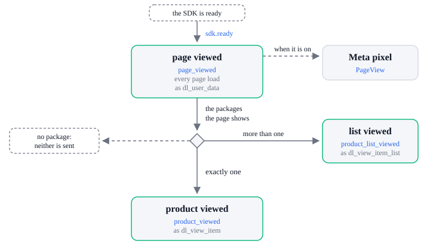

# Page tracking

Tracking events: `page_viewed`, `product_viewed`, `product_list_viewed`.

| Tracking event        | Sent by     | When                                 | `dl_*` push         |
| --------------------- | ----------- | ------------------------------------ | ------------------- |
| `page_viewed`         | `sdk.ready` | Every page load                      | `dl_user_data`      |
| `product_viewed`      | `sdk.ready` | The page shows exactly one package   | `dl_view_item`      |
| `product_list_viewed` | `sdk.ready` | The page shows more than one package | `dl_view_item_list` |

A package the page shows is a `data-next-package-id` the campaign has, counted once. The Meta
pixel, when on, gets `PageView` for `page_viewed`. [How analytics works](../how-it-works.md) says
when analytics loads and how events from before it are read back.
