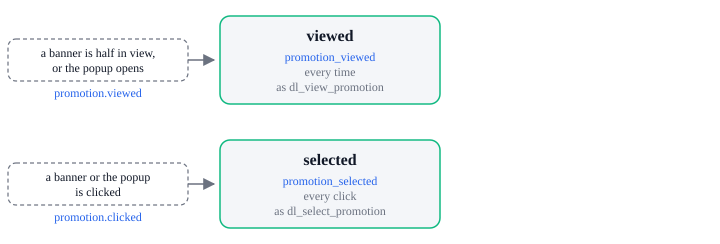

# Promotion tracking

Tracking events: `promotion_viewed`, `promotion_selected`.

| Tracking event       | Sent by             | When                              | `dl_*` push           |
| -------------------- | ------------------- | --------------------------------- | --------------------- |
| `promotion_viewed`   | `promotion.viewed`  | Every time a promotion is shown   | `dl_view_promotion`   |
| `promotion_selected` | `promotion.clicked` | Every time a promotion is clicked | `dl_select_promotion` |

A click does not wait for a view, and `promotion.closed` sends no tracking event. The exit-intent
popup's own `dl_exit_intent_*` pushes are on the [GTM](../destinations/gtm.md) page;
[How analytics works](../how-it-works.md) has the rest.
