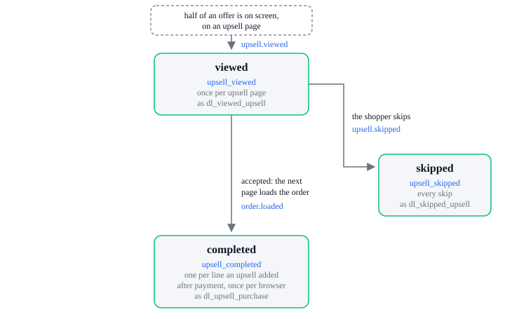

# Upsell tracking

Tracking events: `upsell_viewed`, `upsell_skipped`, `upsell_completed`.

| Tracking event     | Sent by          | When                                                                                       | `dl_*` push          |
| ------------------ | ---------------- | ------------------------------------------------------------------------------------------ | -------------------- |
| `upsell_viewed`    | `upsell.viewed`  | Once per upsell page                                                                       | `dl_viewed_upsell`   |
| `upsell_skipped`   | `upsell.skipped` | Every time an upsell is skipped                                                            | `dl_skipped_upsell`  |
| `upsell_completed` | `order.loaded`   | One per line an upsell added after payment, once per browser: on the page after the upsell | `dl_upsell_purchase` |

An `is_upsell` line paid with the order is part of `checkout_completed`, in
[Order tracking](../orders/lifecycle.md), and sends no `upsell_completed`. See
[Each event comes once](../how-it-works.md#each-event-comes-once).
