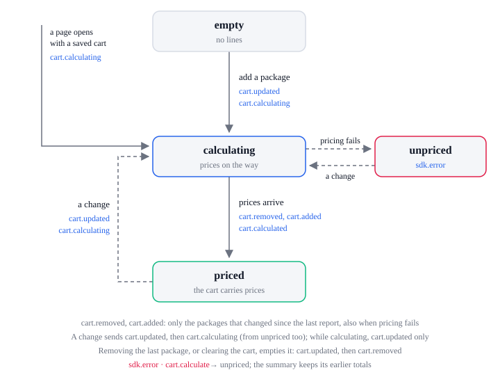

# Cart lifecycle

| State         | Means                                                                                                                                                 |
| ------------- | ----------------------------------------------------------------------------------------------------------------------------------------------------- |
| `empty`       | No lines                                                                                                                                              |
| `calculating` | Lines changed; the server's prices are on the way                                                                                                     |
| `priced`      | The cart carries the server's prices                                                                                                                  |
| `unpriced`    | Pricing failed: events carry no prices, and `data-next-cart-summary` gets `next-price-failed` while it still shows the totals from before that change |

| From                                | What happens                                                            | To            | Events, in order                                                                            |
| ----------------------------------- | ----------------------------------------------------------------------- | ------------- | ------------------------------------------------------------------------------------------- |
| `empty`                             | A package is added                                                      | `calculating` | `cart.updated`, `cart.calculating`                                                          |
| `calculating`                       | Another change before the prices arrive                                 | `calculating` | `cart.updated`; no second `cart.calculating`, and only the latest request's prices are used |
| `calculating`                       | The server prices the cart                                              | `priced`      | `cart.removed`, `cart.added` (the net change), `cart.calculated`                            |
| `calculating`                       | Pricing fails                                                           | `unpriced`    | `sdk.error` (`cart.calculate`), `cart.removed`, `cart.added` at the campaign's prices       |
| `priced`, `unpriced`                | A package, a quantity, a coupon or the shipping method changes          | `calculating` | `cart.updated` (then `coupon.applied` or `coupon.removed` for a coupon), `cart.calculating` |
| `priced`                            | A coupon takes nothing off                                              | `priced`      | `coupon.denied`; the cart does not change                                                   |
| `priced`                            | A coupon entered while the cart was empty turns out to take nothing off | `calculating` | `coupon.denied`, `cart.updated` (the code is removed), `cart.calculating`                   |
| `calculating`, `priced`, `unpriced` | The last package is removed, or the cart is cleared                     | `empty`       | `cart.updated`, `cart.removed`                                                              |

Before the campaign loads, a change sends `cart.updated` only; pricing starts once it has loaded.

## Errors

Each sends `sdk.error` with this `action`. The SDK lifecycle lists every action and `code`.

| `action`         | When                      | What the SDK does next                                                            |
| ---------------- | ------------------------- | --------------------------------------------------------------------------------- |
| `cart.calculate` | The cart cannot be priced | The cart is `unpriced`; the summary keeps its totals and gets `next-price-failed` |
