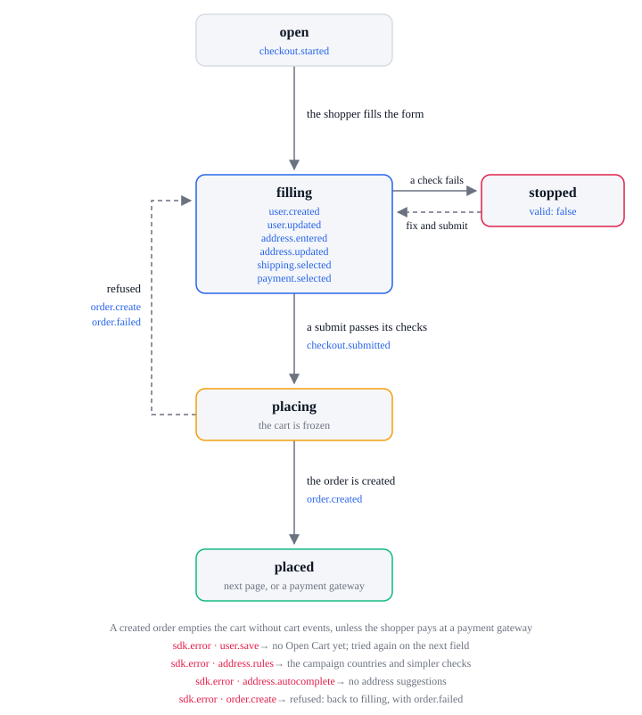
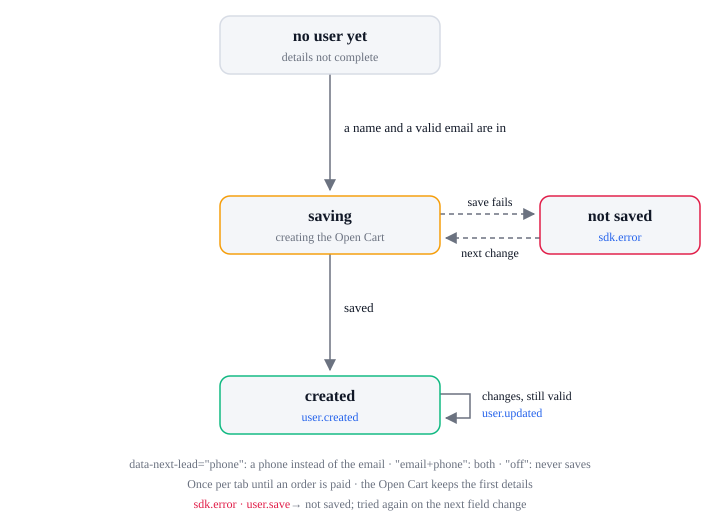
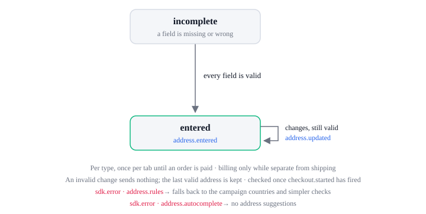

# Checkout lifecycle

| State              | Means                                                                                                        |
| ------------------ | ------------------------------------------------------------------------------------------------------------ |
| `open`             | The checkout form is bound with a cart                                                                       |
| `filling`          | The shopper fills in the form, and fixes what a submit pointed out                                           |
| `submitting`       | The SDK checks the form, that the cart has lines, and the card; the cart is frozen and ignores changes       |
| `placing`          | The order is being sent; the cart stays frozen                                                               |
| `awaiting payment` | The order exists but is not paid yet; the shopper pays at its `payment_complete_url` (PayPal, 3-D Secure, …) |
| `paid`             | The order is paid; the cart is emptied                                                                       |

| From               | What happens                                                                                                                                                     | To                 | Events                                                                                                                      |
| ------------------ | ---------------------------------------------------------------------------------------------------------------------------------------------------------------- | ------------------ | --------------------------------------------------------------------------------------------------------------------------- |
| none               | The form is bound and the cart has lines                                                                                                                         | `open`             | `checkout.started`, once                                                                                                    |
| `open`             | The shopper fills in the form                                                                                                                                    | `filling`          | in any order: `user.created`, `user.updated`, `address.entered`, `address.updated`, `shipping.selected`, `payment.selected` |
| `filling`          | The shopper submits, or uses an express button                                                                                                                   | `submitting`       | none                                                                                                                        |
| `submitting`       | A check fails: a field, an empty cart, or the card                                                                                                               | `filling`          | `checkout.submitted` (`valid: false`, with the `errors`)                                                                    |
| `submitting`       | The checks pass and the card is tokenized; an express button skips the form checks                                                                               | `placing`          | `checkout.submitted` (`valid: true`)                                                                                        |
| `placing`          | The server refuses the order                                                                                                                                     | `filling`          | `sdk.error` (`order.create`), `order.failed` (`stage: 'order'`)                                                             |
| `placing`          | The order is created without a `payment_complete_url`: it is paid, and the shopper is redirected to the next page (`next-success-url`, or the order status page) | `paid`             | `order.created`, then `order.loaded` and `order.paid` on the next page                                                      |
| `placing`          | The order is created with a `payment_complete_url`: the shopper is redirected there to pay                                                                       | `awaiting payment` | `order.created`                                                                                                             |
| `awaiting payment` | The payment is completed; the gateway redirects the shopper to the next page, which loads the order                                                              | `paid`             | `order.loaded`, `order.paid`                                                                                                |
| `awaiting payment` | The payment fails; the gateway redirects the shopper back to the checkout, cart kept                                                                             | `filling`          | `order.failed` (`stage: 'payment'`) when the page opens with the order's `ref_id`; `param.payment_failed` is `'true'`       |

A paid order empties the cart without cart events. While payment is awaited the cart is kept
until the paid order loads, so a shopper whose payment fails comes back to the same cart. See the order
lifecycle.

Each event carries its own object: `checkout.started` and `checkout.submitted` the Checkout (the
Cart as `cart`, the `user`, the addresses, `billing_same_as_shipping` and `payment_method`, with
`valid` and `errors` on `checkout.submitted`), `user.*` the User, `address.*` the Address with its
`type`, `shipping.selected` the ShippingMethod and `payment.selected` the Payment.

## User

`user.created` fires once per tab, when the checkout saves the shopper as a lead: their first and
last name and email by default, or what `data-next-lead` asks for (see Lead capture in
[Attributes](../../attributes.md#lead-capture)). The Open Cart keeps those first details;
`user.updated` fires when they change and are still valid. `language`, `ip` and `user_agent` are
what the store recorded with the Open Cart.

## Address

`address.entered` fires once per `type`, when that address is valid: every field its country
requires passes its check, and so does each optional field the shopper filled. `address.updated`
fires when it changes and is still valid. A `billing` address is sent only while billing is
separate from shipping; `billing_same_as_shipping` on the Checkout says which.

## Errors

Each sends `sdk.error` with this `action`. The SDK lifecycle lists every action and `code`.

| `action`               | When                                              | What the SDK does next                                  |
| ---------------------- | ------------------------------------------------- | ------------------------------------------------------- |
| `user.save`            | The Open Cart cannot be created                   | Tries again when the shopper leaves a field             |
| `address.rules`        | The country list or a country's rules cannot load | Uses the campaign's countries and simpler checks        |
| `address.autocomplete` | Address suggestions cannot load                   | Shows no suggestions                                    |
| `order.create`         | The server refuses the order                      | Back to filling with `order.failed`; the cart unfreezes |
