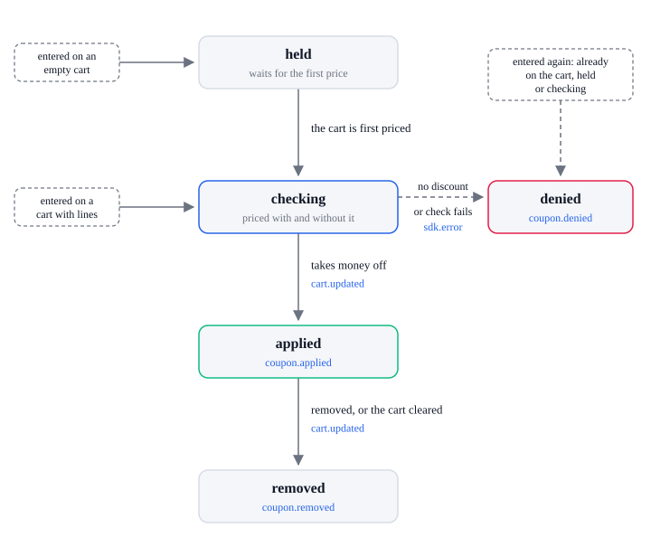

# Coupon lifecycle

| State      | Means                                                                                                                           |
| ---------- | ------------------------------------------------------------------------------------------------------------------------------- |
| `held`     | Entered while the cart is empty or the campaign has not loaded; waits for the cart's first price. Kept across pages in this tab |
| `checking` | The cart is priced with and without the code                                                                                    |
| `applied`  | The code takes money off and is on the cart                                                                                     |
| `denied`   | The code is not applied; the cart does not change                                                                               |
| `removed`  | The code was taken off the cart                                                                                                 |

| From               | What happens                                                                           | To         | Events, in order                                                                                                         |
| ------------------ | -------------------------------------------------------------------------------------- | ---------- | ------------------------------------------------------------------------------------------------------------------------ |
| none               | A code is entered and the cart has lines                                               | `checking` | none                                                                                                                     |
| none               | A code is entered while the cart is empty, or before the campaign loads                | `held`     | none                                                                                                                     |
| none               | The code is already on the cart (a bundle card's own code too), held, or being checked | `denied`   | `coupon.denied` (`reason: 'duplicate'`)                                                                                  |
| `held`             | The cart is priced for the first time                                                  | `checking` | none, after `cart.calculated`                                                                                            |
| `checking`         | The code takes money off                                                               | `applied`  | `cart.updated`, `coupon.applied` (with `amount` and `discounts`), then `cart.calculating`, `cart.calculated`             |
| `checking`         | The code takes nothing off this cart                                                   | `denied`   | `coupon.denied` (`reason: 'no_discount'`)                                                                                |
| `checking`         | The code cannot be checked                                                             | `denied`   | `sdk.error` (`coupon.check`), `coupon.denied` (`reason: 'check_failed'`, with `message`)                                 |
| `held`, `checking` | `removeCoupon`, or the cart is cleared                                                 | none       | none; `applyCoupon` resolves `false`                                                                                     |
| `applied`          | `removeCoupon`                                                                         | `removed`  | `cart.updated`, `coupon.removed` (`reason: 'shopper'`), then `cart.calculating`, `cart.calculated` if the cart has lines |
| `applied`          | The cart is cleared                                                                    | `removed`  | `cart.updated`, `cart.removed`, `coupon.removed` (`reason: 'cleared'`)                                                   |

`next.actions.applyCoupon` resolves `true` once the code is applied, and `false` when it is denied
or dropped. For a held code it resolves when the code is checked, if that happens on the same page;
a held code still waiting on a later page is checked there once the cart is priced. The 0.4.x
`next.applyCoupon` resolves `true` at once for a code it holds.

While an order is being placed the cart is frozen: `applyCoupon` resolves `false`, `removeCoupon`
does nothing, and no coupon event is sent. A code whose check ends after the cart froze is not
applied and sends nothing; a held code stays held.

Codes are uppercase. `coupon.applied` carries what the code takes off this cart, as `amount` and
the `discounts` with its `code`. The cart's own `discounts`, or `shipping_method.discounts` for
shipping, list it with `source` `coupon` and the same `code` from the next `cart.calculated`, and
follow the cart as it changes. Applying or removing a code prices every selector's options again;
see the selector lifecycle.

## Errors

Each sends `sdk.error` with this `action`. The SDK lifecycle lists every action and `code`.

| `action`       | When                     | What the SDK does next                                                        |
| -------------- | ------------------------ | ----------------------------------------------------------------------------- |
| `coupon.check` | A code cannot be checked | `coupon.denied` with `reason: 'check_failed'`; `applyCoupon` resolves `false` |
