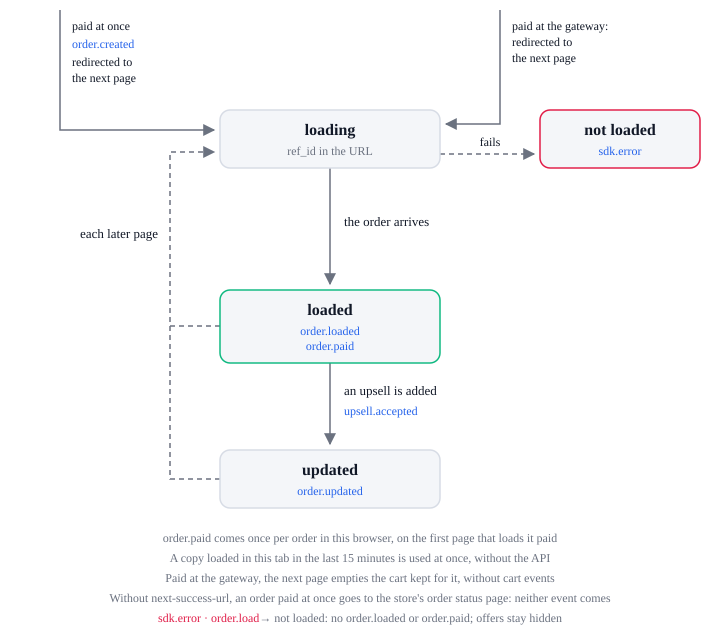

# Order lifecycle

Events: `order.*`, with `upsell.accepted` before `order.updated`, the checkout's
`checkout.completed` after a gateway, and `payment.failed` on a page loaded back unpaid.

The lifecycle is one order's, on each page after the checkout whose URL has `ref_id` or
`order_ref_id`; the order state's `status` is the state.

| State       | Means                                                                           |
| ----------- | ------------------------------------------------------------------------------- |
| `idle`      | The page has not asked for the order: no `ref_id` in its URL, or not yet        |
| `loading`   | The order is fetched from the API, 10 seconds at most                           |
| `ready`     | The page has the order: its values show, and the offers it takes are shown      |
| `accepting` | An upsell is sent to the order; the offer's buttons get `next-disabled`         |
| `failed`    | The order could not load: the page shows no order values and offers stay hidden |

| From        | What happens                                                                                       | To                   | Events, in order                                                                                                                                     |
| ----------- | -------------------------------------------------------------------------------------------------- | -------------------- | ---------------------------------------------------------------------------------------------------------------------------------------------------- |
| none        | The checkout, `placed` with an order paid at once, redirects to the next page with `ref_id`        | `idle`               | none here; `order.created` (`paid: true`), `order.paid` and `checkout.completed` came on the checkout                                                |
| none        | The gateway, paid, redirects to the next page with `ref_id`                                        | `idle`               | none here; `order.created` (`paid: false`) and `payment.redirected` came on the checkout                                                             |
| none        | The gateway, unpaid, redirects to the checkout (`idle`) with `payment_failed=true` and no `ref_id` | `idle`               | `payment.failed` (`code: 'payment_failed'`), once per order in this browser                                                                          |
| `idle`      | The URL has `ref_id` or `order_ref_id`, and this tab loaded that order in the last 15 minutes      | `ready`              | `order.loaded`, then `order.paid` the first time this browser has it paid, then `checkout.completed` when this tab's checkout sent it to the gateway |
| `idle`      | The URL has `ref_id` or `order_ref_id`, and no such copy                                           | `loading`            | none                                                                                                                                                 |
| `loading`   | The order arrives                                                                                  | `ready`              | `order.loaded`, then `order.paid` the first time this browser has it paid, then `checkout.completed` when this tab's checkout sent it to the gateway |
| `loading`   | The request fails, or 10 seconds pass                                                              | `failed`             | `sdk.error` (`order.load`)                                                                                                                           |
| `ready`     | The shopper accepts an upsell                                                                      | `accepting`          | none; see the upsell lifecycle                                                                                                                       |
| `accepting` | The upsell is on the order                                                                         | `ready`              | `upsell.accepted`, `order.updated`                                                                                                                   |
| `accepting` | The upsell is not added                                                                            | `ready`              | no `order.*` event; the upsell lifecycle has the rest                                                                                                |
| `ready`     | The shopper moves on to a page whose URL has `ref_id`                                              | `idle`, on that page | none                                                                                                                                                 |

## Which page loads the order

- The order chunk loads on a page with `ref_id`, `order_ref_id` or `payment_failed=true` in its
  URL, or with order markup.
- Order markup: `data-next-upsell`, `data-next-order-items`, or `data-next-display`,
  `data-next-show` or `data-next-hide` with an `order.` value.
- The checkout redirects to `next-success-url` with `ref_id`; without it, to the store's order
  status page, where the SDK does not run: no `order.loaded`, and `order.paid` came on the checkout.
- An upsell button's URL gets `ref_id` added, so each later page loads the order again and sends
  `order.loaded`; the SDK does not carry `ref_id` to other next URLs.

## `order.paid` once

- Once per order in this browser: on the checkout for an order paid at once, else on the first page
  that loads it paid.
- The ledger keeps the last 50 keys, `number` (else `ref_id`) each, in local storage.
- An order loaded while it still awaits payment (`paid: false`) sends `order.loaded` alone.
- When the order this tab's checkout sent to the gateway loads paid, the cart kept for it is emptied
  without cart events, and `checkout.completed` follows `order.paid`.

## `order.updated`

- Comes right after `upsell.accepted`, with the order as the API returned it: the upsell's lines
  marked `upsell: true`.
- The copy kept in this tab is replaced with it, so the next page in the next 15 minutes has the
  upsell at once.
- An accept with no answer (network, timeout, server) loads the order again: when it has the
  upsell's lines, `upsell.accepted` and `order.updated` come as if added.

## What each event carries

- The Order: `ref_id`, `number`, `currency`, `test`, `paid`, `lines`, `coupons`, `total_discount`, `shipping_method`,
  `tax`, `total`, `user`, `shipping_address`, `billing_address`, `payment_method`, `supports_upsells`, `status_url`.
- Prices are numbers in `currency`; `paid` is `false` while the shopper pays at a gateway; `coupons`
  are the codes applied at this tab's checkout of the order, uppercase.
- Each line: `id`, `product_id`, `product_title`, `variant_id`, `variant_title`, `sku`, `image`,
  `quantity`, `price`, `original_price`, `total` and `upsell`.

## Errors

Each sends `sdk.error` with this `action`. The SDK lifecycle lists every action and `code`.

| `action`     | When                                                                | What the SDK does next                                                                                                                               |
| ------------ | ------------------------------------------------------------------- | ---------------------------------------------------------------------------------------------------------------------------------------------------- |
| `order.load` | A page after the checkout cannot load the order, or 10 seconds pass | No `order.loaded`, nor `order.paid` after a gateway; the page shows no order values and offers stay hidden; after a gateway payment the cart is kept |
