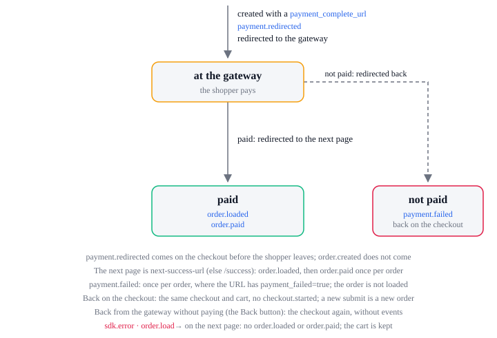

# Payment lifecycle

Events: `payment.redirected` and `payment.failed`, with the order's `order.created`, `order.loaded`
and `order.paid` and the checkout's `checkout.completed`.

The lifecycle is one order's payment, across pages: from the checkout that creates the order with a
`payment_complete_url` (PayPal, Klarna, a wallet, 3-D Secure, …) to the page that loads it paid, or
the page it comes back to unpaid. A card declined on the checkout, and a declined upsell, are here
too; a card paid at once stays in the checkout lifecycle.

| State            | Means                                                                                                                        |
| ---------------- | ---------------------------------------------------------------------------------------------------------------------------- |
| `at the gateway` | The order exists unpaid; the shopper pays at its `payment_complete_url`, and the checkout keeps its `ref_id` as `pendingRef` |
| `paid`           | A page loaded the order paid                                                                                                 |
| `not paid`       | The payment was not taken: on the checkout the shopper has the same cart; on an upsell page the order stays as it was        |

| From                         | What happens                                                                       | To               | Events, in order                                                                                                                                                                                           |
| ---------------------------- | ---------------------------------------------------------------------------------- | ---------------- | ---------------------------------------------------------------------------------------------------------------------------------------------------------------------------------------------------------- |
| none                         | On the checkout, the order is created with a `payment_complete_url`                | `at the gateway` | `order.created` (`paid: false`), `payment.redirected` (`method`, `ref_id`, `url`); then the page redirects to `url`, with the cart kept                                                                    |
| none                         | On the checkout, the card is declined; the checkout goes `placing` → `idle`        | `not paid`       | `payment.failed` (`method`, `error` with `code: 'declined'` and `decline_code`; no `ref_id`)                                                                                                               |
| none                         | On an upsell page, the offer's payment is declined                                 | `not paid`       | `payment.failed` (`method`, `ref_id`, `error` with `code: 'declined'`); see the upsell lifecycle                                                                                                           |
| `at the gateway`             | Paid; the gateway sends the shopper to the next page, which loads the order        | `paid`           | `order.loaded`, then `order.paid` the first time this browser has it paid, then `checkout.completed` when this tab's checkout sent the shopper; the cart kept for the order is emptied without cart events |
| `at the gateway`             | A page loads the order before it is paid                                           | `at the gateway` | `order.loaded` (`paid: false`); the cart is kept                                                                                                                                                           |
| `at the gateway`             | Not paid; the gateway sends the shopper back with `payment_failed=true` in the URL | `not paid`       | `payment.failed` (`method`, `ref_id`, `error` with `code: 'payment_failed'`), once per order                                                                                                               |
| `at the gateway`             | The shopper comes back without paying, such as with the browser's Back button      | `at the gateway` | none; the checkout page loads again at `idle`, still waiting for the order                                                                                                                                 |
| `at the gateway`, `not paid` | The shopper submits again                                                          | none             | none here: a new order, from `placing` in the checkout lifecycle; it replaces the one waited for                                                                                                           |

## Paid at the gateway

- The gateway sends the shopper to `next-success-url`, else `/success` on the site, with the order's
  `ref_id` (or `order_ref_id`); that page loads the order. See the order lifecycle.
- `order.paid` comes once per order in this browser. `checkout.completed` comes once, when the tab's
  saved checkout has `pendingRef` for the order: it ends the checkout; the next one gets a new `id`.
- The cart kept for the order is emptied without cart events; `checkout.completed` still carries it.
- In another tab, or once the checkout has ended, the order loads with `order.loaded` and
  `order.paid` but no `checkout.completed`.

## Back unpaid

- The gateway sends the shopper to `next-failure-url`, else the checkout page with
  `payment_failed=true`; the store adds `payment_failed=true` and `payment_method` to either.
- `payment.failed` comes on that page when its URL has `payment_failed=true` and no `ref_id`, once
  per order. The order is not loaded: the store has nothing to load until it is paid.
- `method` is the URL's `payment_method` unless it is `None`, else the method the order was placed
  with, else the method picked in the form.
- Same checkout, same cart: `checkout.started` does not come again. The URL loses `payment_failed`
  and `payment_method` once read; `param.payment_failed` stays `'true'` for `data-next-show`.

## Declined

- A decline is `payment_response_code` or `payment_details` in the store's answer; `error` carries
  them as `decline_code` and `message`, plus the HTTP `status`. Other refusals: `checkout.failed`.
- The checkout shows the shopper `payment.errors.<decline_code>` from the address service, in the
  page's [language](../../attribute-reference/setup/language.md), or `payment.errors.generic` for a
  code with no sentence of its own; never `message`, the gateway's English. A page that writes its
  own reads the same keys: [Payment errors](https://i18n-rules-docs.next-commerce.workers.dev/reference/payment-errors/).
- On the checkout, no order was created, so no `ref_id`; the checkout goes back to `idle` with the
  error on the form, and the cart unfreezes.
- On an upsell page, `method` is the order's `payment_method`; the order stays as it was, and the
  page goes on to the next one after a second. `upsell.failed` does not come.

## What each event carries

- `payment.redirected`: the Payment's `method`, the order's `ref_id` and the gateway `url`.
- `payment.failed`: `method`, `ref_id` (none for a card declined on the checkout) and `error`:
  `code: 'declined'` with `decline_code`, `status` and `message`, or `code: 'payment_failed'`.
- `order.created`: the Order the store returned when it created it, `paid: false`; `order.loaded`
  and `order.paid`: its details once paid.
- `checkout.completed`: the Checkout that sent the shopper to the gateway, with its cart before it
  is emptied, the order's `payment_method` and its `ref_id`.

## Errors

A payment that is not taken is not an SDK failure: `payment.failed` comes without `sdk.error`. The
SDK lifecycle lists every action and `code`.

| `action`     | When                                                                                      | What the SDK does next                                                                      |
| ------------ | ----------------------------------------------------------------------------------------- | ------------------------------------------------------------------------------------------- |
| `order.load` | The next page cannot load the order paid at the gateway; the SDK waits 10 seconds at most | No `order.loaded`, `order.paid` or `checkout.completed`; the cart and the checkout are kept |
