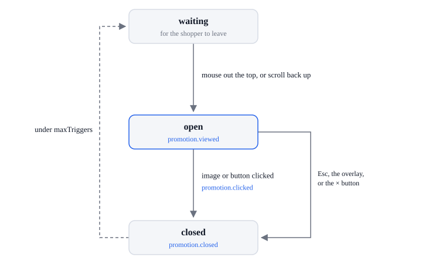

# Promotion lifecycle

| State     | Means                                                                          |
| --------- | ------------------------------------------------------------------------------ |
| `waiting` | The exit-intent popup waits for the shopper to leave                           |
| `open`    | The popup is on the page                                                       |
| `clicked` | The shopper clicked its image or a `data-exit-intent-action` button; it closes |
| `closed`  | The shopper closed it without a click                                          |

| From                | What happens                                                                                                                                                                                  | To        | Events, in order                                                                                                    |
| ------------------- | --------------------------------------------------------------------------------------------------------------------------------------------------------------------------------------------- | --------- | ------------------------------------------------------------------------------------------------------------------- |
| none                | The page calls `next.exitIntent({ image })` or `({ template })`                                                                                                                               | `waiting` | none; a template missing from the page logs a warning and never opens                                               |
| `waiting`           | Desktop: the mouse leaves through the top of the window. Touch screen, with `mobileScrollTrigger` or `disableOnMobile: false`: past 30% of a screen, then a scroll back up of more than 100px | `open`    | `promotion.viewed`                                                                                                  |
| `open`              | The image or a `data-exit-intent-action` button is clicked; `apply-coupon` applies its code first                                                                                             | `clicked` | `coupon.applied` or `coupon.denied` (apply-coupon), then `promotion.clicked` (`action`, `coupon_code` for a button) |
| `open`              | Esc or the overlay                                                                                                                                                                            | `closed`  | `promotion.closed` (`reason: 'dismissed'`)                                                                          |
| `open`              | The × button (`showCloseButton`, off by default)                                                                                                                                              | `closed`  | `promotion.closed` (`reason: 'closed'`)                                                                             |
| `clicked`, `closed` | It has opened fewer than `maxTriggers` times this tab session (1 by default)                                                                                                                  | `waiting` | none                                                                                                                |
