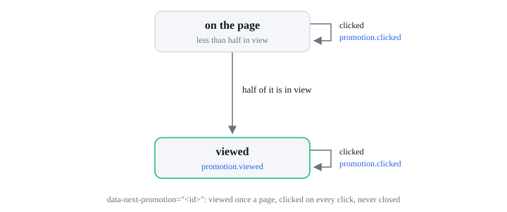

# Promotion lifecycle

A promotion is the exit-intent popup (`type: 'exit_intent'`) or an element the page marks with
`data-next-promotion` (`type: 'banner'`). Every promotion event carries its `Promotion`: `id`,
`type`, and `name` and `creative` when set.

## Exit-intent popup

| State     | Means                                    |
| --------- | ---------------------------------------- |
| `waiting` | The popup waits for the shopper to leave |
| `open`    | The popup is on the page                 |
| `closed`  | The popup closed                         |

| From      | What happens                                                                                                                          | To        | Events, in order                                                                                                                                                                         |
| --------- | ------------------------------------------------------------------------------------------------------------------------------------- | --------- | ---------------------------------------------------------------------------------------------------------------------------------------------------------------------------------------- |
| none      | The page calls `next.exitIntent({ image })` or `({ template })`                                                                       | `waiting` | none. A template missing from the page falls back to `image`, else warns each time it would open. On a touch screen it waits only with `mobileScrollTrigger` or `disableOnMobile: false` |
| `waiting` | Desktop: the mouse leaves through the top of the window. Touch screen: past 30% of a screen, then a scroll back up of more than 100px | `open`    | `promotion.viewed`                                                                                                                                                                       |
| `open`    | The image or a `data-exit-intent-action` button is clicked                                                                            | `closed`  | `promotion.clicked` (with `action` and `coupon_code` for a button), then its action runs, then `promotion.closed` (`reason: 'clicked'`)                                                  |
| `open`    | Esc, or the overlay (`overlayClosable`, on by default)                                                                                | `closed`  | `promotion.closed` (`reason: 'dismissed'`)                                                                                                                                               |
| `open`    | The page removes the popup (the function `next.exitIntent()` resolves to)                                                             | `closed`  | none                                                                                                                                                                                     |
| `open`    | The × button (`showCloseButton`, off by default)                                                                                      | `closed`  | `promotion.closed` (`reason: 'close_button'`)                                                                                                                                            |
| `closed`  | It has opened fewer than `maxTriggers` times this tab session (1 by default)                                                          | `waiting` | none                                                                                                                                                                                     |

`promotion.closed` comes once for each `promotion.viewed`, unless the page removes the popup. `promotion.clicked` comes before the
action runs. An `apply-coupon` button applies its `data-coupon-code` without waiting for it, so its
coupon events (see the coupon lifecycle) can come after `promotion.closed`; the image's action and
a `custom` button's action, `exitIntent({ action })`, are waited for. The page removes the popup,
without `promotion.closed`, with the function `next.exitIntent` resolves to.

The popup's `id` is `exitIntent({ id })`, else `exit_intent`; `name` is `exitIntent({ name })`, and
`creative` the template's name or the image URL.

## Banner

| State         | Means                                                                                |
| ------------- | ------------------------------------------------------------------------------------ |
| `on the page` | An element marked `data-next-promotion` is on the page, less than half of it in view |
| `viewed`      | Half of it has been in view                                                          |

| From                    | What happens                                              | To            | Events, in order                    |
| ----------------------- | --------------------------------------------------------- | ------------- | ----------------------------------- |
| none                    | The page has an element with `data-next-promotion="<id>"` | `on the page` | none                                |
| `on the page`           | Half of it comes into view                                | `viewed`      | `promotion.viewed`, once a page     |
| `on the page`, `viewed` | It is clicked                                             | same state    | `promotion.clicked`, on every click |

A banner's `id` is its `data-next-promotion`, `name` its `data-next-promotion-name` and `creative`
its `data-next-promotion-creative`. A banner never sends `promotion.closed`.

## Errors

A promotion calls no API and sends no `sdk.error` of its own. An `apply-coupon` button's code
follows the coupon lifecycle; a failing `custom` action is logged.

| `action`       | When                                              | What the SDK does next                                                      |
| -------------- | ------------------------------------------------- | --------------------------------------------------------------------------- |
| `coupon.check` | An `apply-coupon` button's code cannot be checked | `coupon.denied` with `reason: 'check_failed'`; the popup has already closed |
