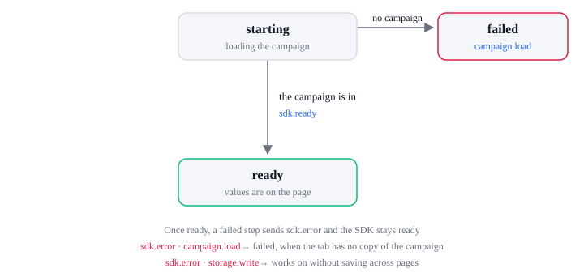

# SDK lifecycle

| State      | Means                                                     |
| ---------- | --------------------------------------------------------- |
| `starting` | The SDK is loading the campaign                           |
| `ready`    | The campaign is in and the page shows its values          |
| `failed`   | The campaign could not load and the tab has no copy of it |

| From       | What happens                                            | To       | Events                                        |
| ---------- | ------------------------------------------------------- | -------- | --------------------------------------------- |
| `starting` | The campaign is in, from the tab's copy or from the API | `ready`  | `sdk.ready`, once; late listeners get it too  |
| `starting` | The campaign cannot load and the tab has no copy        | `failed` | `sdk.error` (`campaign.load`); no `sdk.ready` |
| `ready`    | A step fails; see Errors below                          | `ready`  | `sdk.error`                                   |

## Errors

Every failure sends `sdk.error`: `action` names the step, `code` says why, `status` is the HTTP
status when the API answered, and `message` is for developers and logs, never for shoppers.
`order.failed` and `upsell.failed` follow their `sdk.error` with what the page shows the shopper; a
payment that failed at a gateway sends `order.failed` alone, because the SDK did not fail.

| `action`               | When                                              | What the SDK does next                                                      | Also sent                                   | Likely `code`                               |
| ---------------------- | ------------------------------------------------- | --------------------------------------------------------------------------- | ------------------------------------------- | ------------------------------------------- |
| `campaign.load`        | The campaign cannot load                          | Stops at `failed`, without `sdk.ready`, when the tab has no copy            | `html[data-next-error="campaign"]`          | `network`, `server`, `auth`                 |
| `cart.calculate`       | The cart cannot be priced                         | The cart is `unpriced`; the summary keeps its totals from before the change | `cart.added`, `cart.removed` without prices | `network`, `server`, `rejected`             |
| `selector.quote`       | Bundle cards or a toggle cannot be quoted         | The cards show the campaign's package prices                                | none                                        | `network`, `server`                         |
| `coupon.check`         | A coupon cannot be checked                        | The code is not applied; `applyCoupon` resolves `false`                     | none                                        | `network`, `server`                         |
| `contact.save`         | The Open Cart cannot be created                   | Tries again when the shopper leaves a field                                 | none                                        | `network`, `server`, `rejected`             |
| `address.rules`        | The country list or a country's rules cannot load | Uses the campaign's countries and simpler checks                            | none                                        | `network`, `server`                         |
| `address.autocomplete` | Address suggestions cannot load                   | Shows no suggestions                                                        | none                                        | `network`, `server`                         |
| `order.create`         | The server refuses the order                      | Back to filling; the cart unfreezes                                         | `order.failed` (`stage: 'order'`)           | `declined`, `rejected`, `network`, `server` |
| `order.load`           | A post-purchase page cannot load the order        | The page shows no order values                                              | none                                        | `network`, `timeout`, `server`              |
| `upsell.add`           | The offer cannot be added                         | The shopper can accept again                                                | `upsell.failed`                             | `declined`, `rejected`, `network`           |
| `storage.write`        | Storage is blocked or full                        | Works on without saving the cart across pages                               | none                                        | `unavailable`                               |

| `code`              | Means                                                     |
| ------------------- | --------------------------------------------------------- |
| `network`           | No answer: offline, DNS, CORS, or blocked                 |
| `timeout`           | The SDK stopped waiting, such as the 10-second order load |
| `server`            | The API failed (HTTP 5xx)                                 |
| `rejected`          | The API refused the request (HTTP 4xx)                    |
| `declined`          | The payment gateway declined                              |
| `auth`              | The campaign key is not allowed (HTTP 401, 403)           |
| `too_many_requests` | Rate limited (HTTP 429)                                   |
| `unavailable`       | Browser storage is blocked or full                        |
