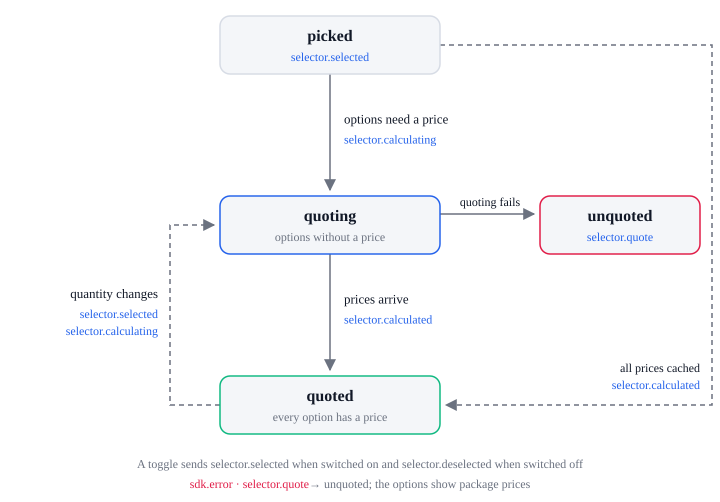

# Selector lifecycle

An option is a card in a selector (`data-next-bundle-card`); `option_id` is its `data-next-bundle-id`.

| State      | Means                                                          |
| ---------- | -------------------------------------------------------------- |
| `picked`   | The selector is registered and an option is picked             |
| `quoting`  | The options with no price yet are being priced                 |
| `quoted`   | Every option has a price                                       |
| `unquoted` | Pricing failed; the options show the campaign's package prices |

| From                 | What happens                                                       | To         | Events                                                        |
| -------------------- | ------------------------------------------------------------------ | ---------- | ------------------------------------------------------------- |
| none                 | The selector is registered and its first option picked             | `picked`   | `selector.selected`                                           |
| `picked`             | Some options have no price from the last 10 minutes                | `quoting`  | `selector.calculating`                                        |
| `picked`             | Every option has a price from the last 10 minutes                  | `quoted`   | `selector.calculated`                                         |
| `quoting`            | The prices arrive                                                  | `quoted`   | `selector.calculated`                                         |
| `quoting`            | Pricing fails                                                      | `unquoted` | `sdk.error` (`selector.quote`)                                |
| `quoted`             | Another option is picked                                           | `quoted`   | `selector.selected`                                           |
| `quoted`, `unquoted` | The picked option's quantity, a slot, or the cart's coupons change | `quoting`  | `selector.selected` (not for coupons), `selector.calculating` |

`selector.selected` carries the option's lines with the product, as in the cart, and their prices
once the option has a price. The price that is paid comes with the cart on `cart.*`.

A toggle (a bump such as a warranty) sends `selector.selected` when it is switched on and
`selector.deselected` when it is switched off, with `type: 'toggle'`, and is priced the same way.

## Errors

Each sends `sdk.error` with this `action`. The SDK lifecycle lists every action and `code`.

| `action`         | When                                 | What the SDK does next                         |
| ---------------- | ------------------------------------ | ---------------------------------------------- |
| `selector.quote` | Options or a toggle cannot be priced | The options show the campaign's package prices |
