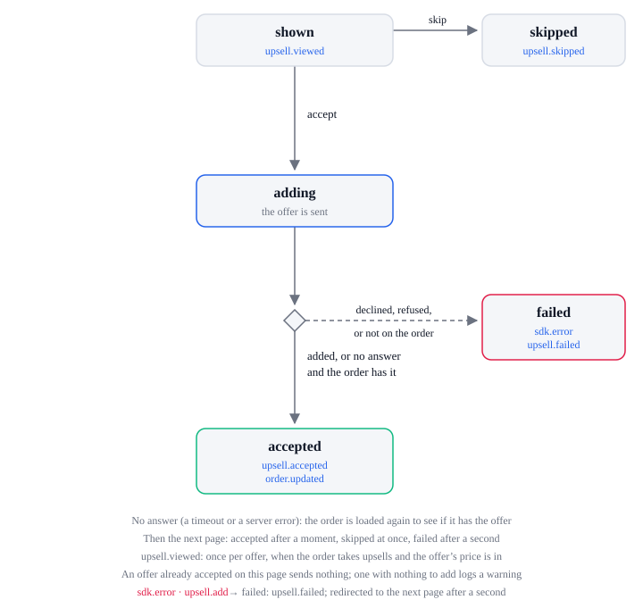

# Upsell lifecycle

| State      | Means                                                  |
| ---------- | ------------------------------------------------------ |
| `shown`    | An offer is on the page                                |
| `adding`   | The offer is being added to the order                  |
| `accepted` | The offer was added; the shopper goes to the next page |
| `skipped`  | The shopper went on without the offer                  |
| `failed`   | Adding the offer failed, such as a decline             |

| From     | What happens                                        | To         | Events                                                       |
| -------- | --------------------------------------------------- | ---------- | ------------------------------------------------------------ |
| none     | The upsell page loads the order and shows the offer | `shown`    | `order.loaded`, `order.paid` the first time, `upsell.viewed` |
| `shown`  | The shopper accepts                                 | `adding`   | none                                                         |
| `adding` | The offer is added                                  | `accepted` | `upsell.accepted` (with the updated `order`)                 |
| `adding` | Adding fails                                        | `failed`   | `sdk.error` (`upsell.add`), `upsell.failed`                  |
| `failed` | The shopper accepts again                           | `adding`   | none                                                         |
| `shown`  | The shopper skips it                                | `skipped`  | `upsell.skipped`                                             |

An offer already accepted on that page is not charged again, and an order that does not take
upsells is never sent one.

## Errors

Each sends `sdk.error` with this `action`. The SDK lifecycle lists every action and `code`.

| `action`     | When                      | What the SDK does next                        |
| ------------ | ------------------------- | --------------------------------------------- |
| `upsell.add` | The offer cannot be added | `upsell.failed`; the shopper can accept again |
