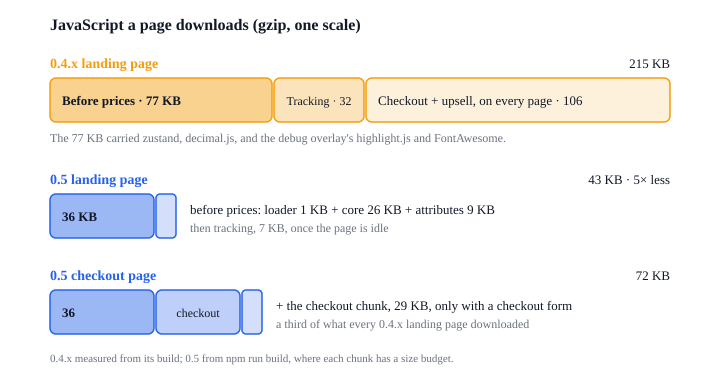

# What 0.5 improves

0.5 is a new SDK under the same attributes. One engine holds the campaign, cart, checkout and
order; the page's attributes and every listener read from it. Pages built for 0.4.x keep working
(see [Migrating from 0.4.x](migrating-from-0.4.md)). What a shopper and a page builder get from it:

## Less JavaScript

JavaScript a landing page downloads, gzip:

|                                         | 0.4.x      | 0.5                         |
| --------------------------------------- | ---------- | --------------------------- |
| Before the page shows prices            | 77 KB      | 26 KB                       |
| Tracking                                | 32 KB      | 5 KB, when the page is idle |
| Checkout and upsell code, on every page | 106 KB     | none                        |
| **Total**                               | **215 KB** | **31 KB**                   |

About **7× less** in all, and 3× less before the first price. 0.5 loads the rest only where it
is used:

| Code     | Loaded when                                     | gzip  |
| -------- | ----------------------------------------------- | ----- |
| checkout | the page has `form[data-next-checkout]`         | 25 KB |
| order    | an upsell or receipt page (`ref_id`, `order.*`) | 5 KB  |
| slots    | a bundle selector with variant slots            | 2 KB  |
| debug    | `?debug=1`                                      | 39 KB |

A checkout page with all of it downloads about 56 KB, a quarter of what every 0.4.x landing page
did. The 0.4.x core carried zustand, decimal.js, and the debug overlay's highlight.js and
FontAwesome; 0.5 has no runtime dependencies, and its debug panel is not downloaded unless
`?debug=1` asks for it. Each piece has a size budget, and the build fails when one is passed.

## Prices sooner

- The campaign is requested by the 1 KB loader while the rest of the SDK is still downloading.
- The campaign is kept for 10 minutes, so the next page, a reload or a new tab shows prices at
  once and updates them when the fresh campaign arrives.
- A bundle card's server price is kept for 10 minutes too: the next page or a quantity the shopper
  picked before shows it without asking the server again.
- `html[data-next-ready]` marks the moment values are on the page; `html[data-next-error]` tells
  the page when loading failed, so it can show its own message.

## Events you can build on

- **One name per change, shaped like Next Commerce webhooks**: `cart.added`, `checkout.started`,
  `order.paid`. Each comes once, in order, with the same envelope (`event_id`, `event_type`,
  `data`, `created_at`, `session_id`). See [Events](events.md).
- **A script that loads late misses nothing.** `next.on` first replays the events this page
  already sent.
- **Every event has its own page** in the Event Reference, generated from the SDK's types with
  an example recorded from a real checkout, so the fields always match the shipped code.
- **`order.paid` comes once per order**, however it was paid, on the page after the checkout.
- **Tracking events have their own listener**: `next.analytics.on('product_added_to_cart', fn)`,
  named in the storefront style and carrying the same objects as `next.on`, with a `context`. Each
  [destination](analytics-reference/destinations/overview.md) remaps them: GTM gets the 0.4.x
  `dl_*` pushes as before, and GA4, the Meta pixel and RudderStack are built in, off until turned on.

## Errors that say what happened

`sdk.error` names the step that failed (`cart.calculate`, `order.create`, …), the reason
(`network`, `timeout`, `declined`, …) and the HTTP status. Each lifecycle page in the Event
Reference lists the errors of its group and what the SDK does next.

The console stays quiet for shoppers: warnings and errors only, and `?debug=1` shows everything.
`next.log.entries()` keeps the last 200 entries whatever the level, and the debug panel shows the
cart, checkout, journey and tracking of the tab.

## Fewer things to learn

- **One way to do each thing.** A bundle selector for one-of-N picks, a toggle card for an order
  bump, an offer for an upsell. Bundle cards, offers and bumps share the `selector.*` events.
- **Page UI stays the page's.** Countdowns, accordions, tooltips and popups are page code; the
  0.4.x ones keep working and are deprecated (see
  [Page widgets](migrating-from-0.4.md#page-widgets)).
- **Every attribute has a page** in the Attribute Reference, and each step of a funnel a guide in
  Building Pages.
